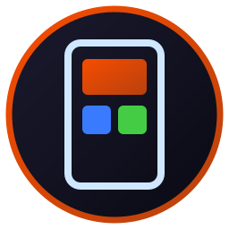

<div align="center">



# OnePage

**[Download for Android (APK)](https://github.com/isene/nomad/releases/download/apk/onepage.apk)** · [how to install](https://isene.org/nomad/#get)

**One screen. Your widgets, placed freely. Nothing else.**

      

A minimal home launcher — part of the [nomad](../../) mobile suite.

</div>

`com.isene.onepage`

## Why

Some launchers (e.g. SmartLauncher) omit `SYSTEM_ALERT_WINDOW` from their
manifest, so ColorOS never lists them under **Display over other apps** and the
Home button can't bring them back over a fullscreen app. There is no user-side
fix. OnePage declares the permission, walks you through granting it once, and
ships its own way home for when ColorOS refuses to cooperate at all.

It also does as close to nothing as a launcher can — no drawer, no icons, no
background work — so it costs essentially zero battery while it sits there being
your home screen.

## What it does

- **One home page.** No drawer, no paging, no dock, no search bar, and no app
  icons on the page: they are in the app panel.
- **App panel.** Swipe up and a card of icons comes up along the bottom of the
  screen, just above the back, home and recent buttons, over the home page or
  over the app you are in.
  - A tap starts an app, calls a number or opens a folder. A tap beside the
    card, Back or Home closes it.
  - Hold the panel to edit. Drag an icon to another slot, or onto a folder to
    put it inside. Leave a row free and you have two groups.
  - A folder is put in order the same way: hold an icon in it, then drag it to
    its place. A tap on an icon there takes it out to the panel or removes it.
  - Tap **+** in a free slot for apps, a folder or a call. The app list shows
    every app with its icon and name, and you can tick several at once.
  - A folder gets a sign you choose among 96 line drawings (a wrench, a plane,
    a shopping cart), or the first letter of its name.
  - **Other apps** is a folder that fills itself: a tap lists every app that
    is nowhere else in the panel, with icon and name. Drag an app onto it and
    the app leaves the panel for that list. Add it or leave it out.
  - **Call** opens the phone's own contact list. The number you pick becomes
    an icon with that contact's picture, and a tap on it calls.
  - The last line in edit mode moves the panel: bottom, right edge, left edge.
  - A chat or a web page gets in through **Add to Home screen** in the app
    that should open it.
  - On the home page the swipe works anywhere on the empty page. In other apps
    it starts at the very bottom edge, and that needs OnePage switched on under
    Accessibility (see First run).
- **Free widget placement** — absolute `(x, y, w, h)`, no grid, overlap allowed.
- **Edit mode** — long-press empty space:
  - drag a widget to move it,
  - two-finger pinch to resize (width and height independently, no aspect lock),
  - long-press a widget to remove it,
  - **+ Widget** lists *every* installed widget (not just the system ones),
  - **Done** / Back / long-press-empty all exit and save.
- **Floating home button** — a small translucent pill, bottom-center over every
  app, that jumps straight to OnePage. It sidesteps the documented
  ColorOS/OxygenOS bug where the real Home button won't return to a third-party
  launcher from a fullscreen app.
- **First-run wizard requests every permission up front** — default-launcher
  role, overlay (the Home-button fix), battery-optimization exemption, and the
  manual ColorOS auto-start step — each verified with auto-advance, so there's
  no after-install settings trawl. Re-run any time: edit mode → **Setup**.
- **Wallpaper shows through** (system-composited, zero cost).

## Battery posture

The launcher is always alive, so the idle path is empty by design:

- **No services doing work, no timers, no polling, no observers.** The one
  foreground service runs zero code after start — it exists only to exempt the
  process from the OEM app-freeze (the Home-button root cause).
- **No drawing or layout when idle.** Widgets invalidate themselves on their own
  `RemoteViews` pushes; the surface draws borders only in edit mode.
- **The widget host keeps listening**, including while you are in another app. A
  stopped host receives nothing and does not reliably get what it missed, so a
  widget sat on the state it had before you opened its app — and going in and
  out again was how you fixed it. Listening costs nothing until a provider
  pushes: one Binder callback when something actually changed, no timer, no
  poll, and no waking anybody to ask.
- **Persistence is one atomic write** on edit-done / add / remove — never per
  drag-tick.
- The floating pill is one inert composited layer; it spends cycles only when
  tapped.
- **The app panel does not exist while it is closed.** Its view is built when
  you swipe and dropped when it closes. An icon is drawn once, off the main
  thread, and kept in memory. The file is written when you change the panel.
- **The app list and the folder signs are read when you ask for them.** The
  icons of the app list are dropped when the list closes. The signs are one
  small file, read the first time a sign is shown.
- **The swipe strip is one empty window**, 14 dp tall along the bottom edge. It
  runs code only when a finger lands on it. The accessibility service behind it
  asks Android for no events and cannot read the screen.

## Architecture

Mostly Android platform-surface code — a launcher hosts third-party widgets, it
doesn't produce one, so the usual nomad shape (Compose + Glance) doesn't fit:

- **Home surface**: a traditional `FrameLayout` (`HomeSurface`) holding
  `AppWidgetHostView` children. `AppWidgetHostView` is a `View`, so wrapping it
  in Compose buys nothing and adds recomposition cost an always-alive process
  shouldn't pay.
- **Compose**: only the one-shot first-run wizard (`WizardActivity`).
- **Rust core** (`core/src/onepage.rs`): owns the layout-file format
  (`Layout { version, widgets: [WidgetPos] }`, serde-json over UniFFI), so a
  desktop tool could read/write a layout later. Kotlin owns all I/O.

## Build

```bash
export JAVA_HOME=/usr/lib/jvm/java-17-openjdk-amd64
export ANDROID_NDK_HOME="$HOME/.android-sdk/ndk/27.2.12479018"
./gradlew :apps:onepage:assembleRelease
```

APK → `apps/onepage/build/outputs/apk/release/`. Sync and sideload.

The tests run on the laptop. Those of the app panel run on Android's own view
code, through [Robolectric](https://robolectric.org), so a fault in a drag or a
list shows before the app is on a phone.

```bash
./gradlew :apps:onepage:testReleaseUnitTest
```

The first run fetches about 390 MB.

## Permissions for calls

OnePage asks for two things, and only when you add your first call icon. You
can say no to both.

- **Phone**: lets a tap on the icon call at once. Without it the tap opens the
  dialler with the number filled in.
- **Contacts**: lets OnePage copy the picture of the one contact you pick.
  Without it the icon is the first letter of the name. OnePage never reads the
  rest of your contacts, and sends nothing anywhere: it has no network access.

## First run

1. Install and open OnePage once.
2. The wizard grants: default-home role → overlay → battery exemption → (manual)
   ColorOS auto-start. Follow it through; everything is verified and auto-advances.
3. Long-press the wallpaper → **+ Widget** → pick one → it appears centered.
   Drag to move, pinch to resize, **Done** to save.
4. The floating pill takes you home from any app.
5. Swipe up on the empty page: the app panel opens, in edit mode while it is
   empty. Tap **+** to fill it.
   The last line there moves the panel to the right or the left edge.
6. To open the panel from any app: Settings → Accessibility → OnePage → on.
   Android refuses this the first time for an app installed from a file. After
   that refusal, open App info for OnePage, tap ⋮, choose **Allow restricted
   settings**, and switch it on again.

> On ColorOS/OxygenOS the hardware/3-button Home action into third-party
> launchers is an OEM bug with no real fix. The floating pill is the reliable
> way home; gesture navigation + locking OnePage's process help too.

## License

[Unlicense](https://unlicense.org/) — public domain. Part of [nomad](../../) · [isene.org/nomad](https://isene.org/nomad/)

The folder signs are from [Lucide](https://lucide.dev), under the ISC License.
Its notice is at the top of `src/main/assets/signs.txt`.
